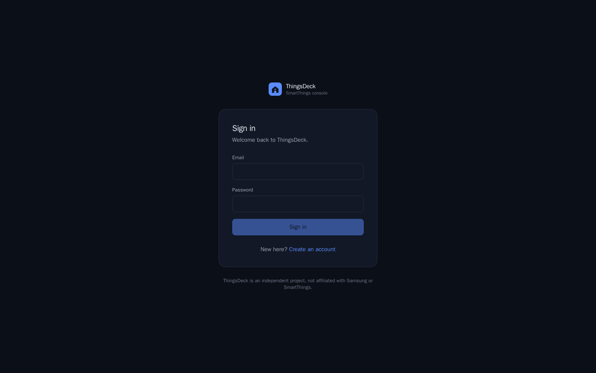
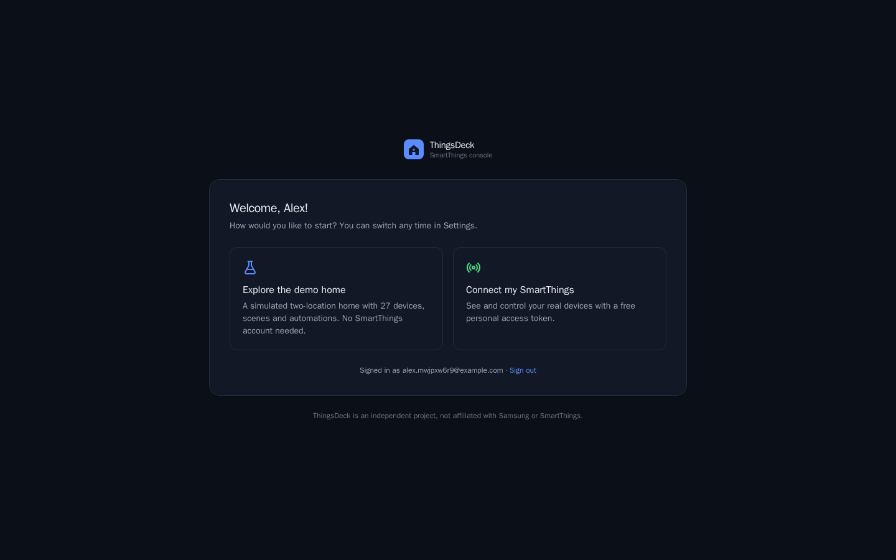
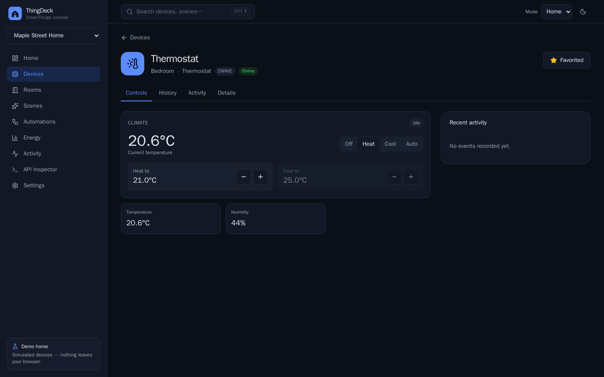
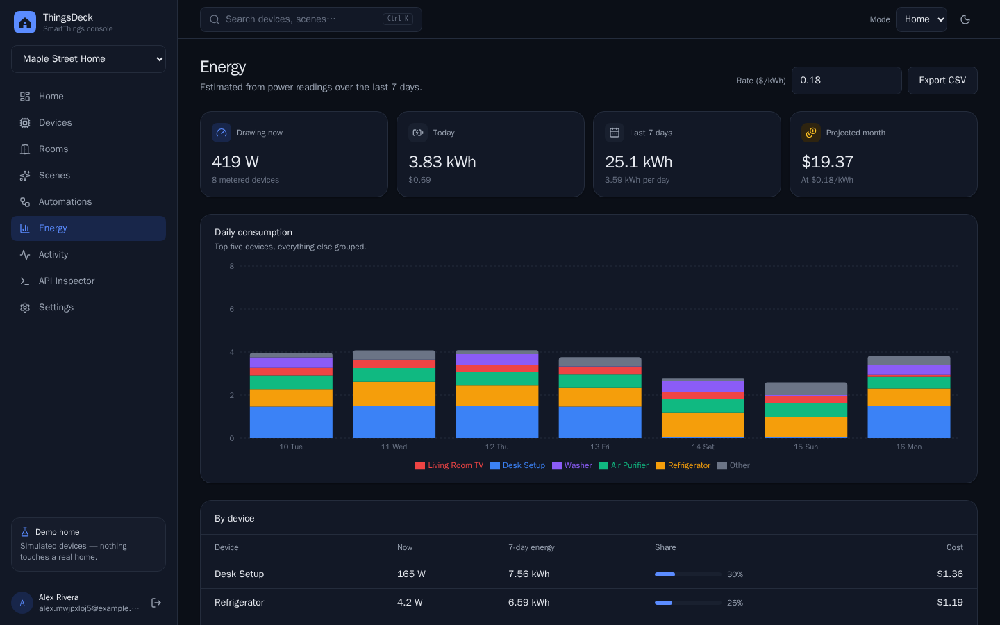
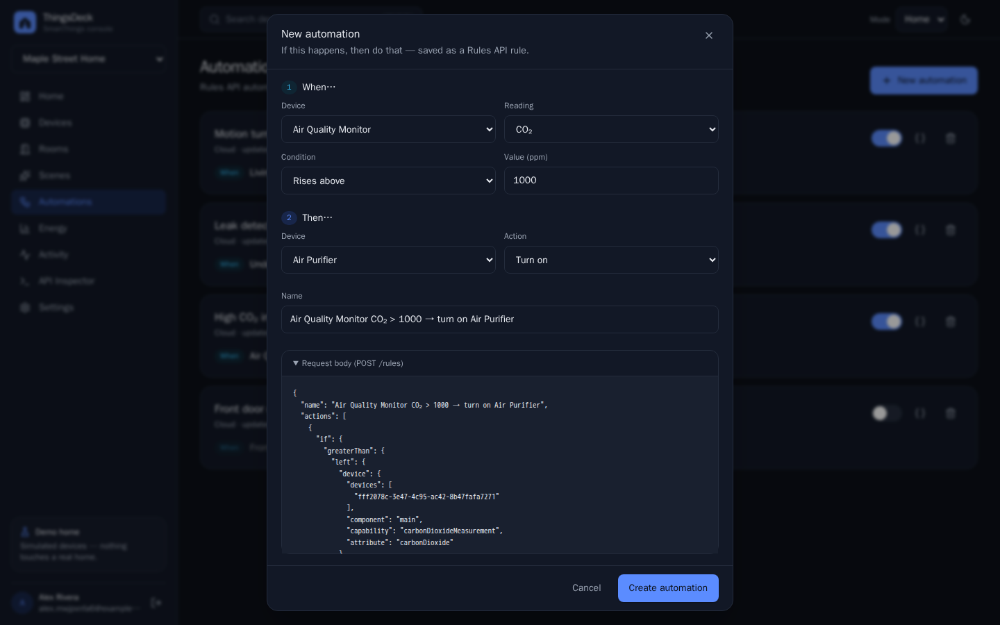
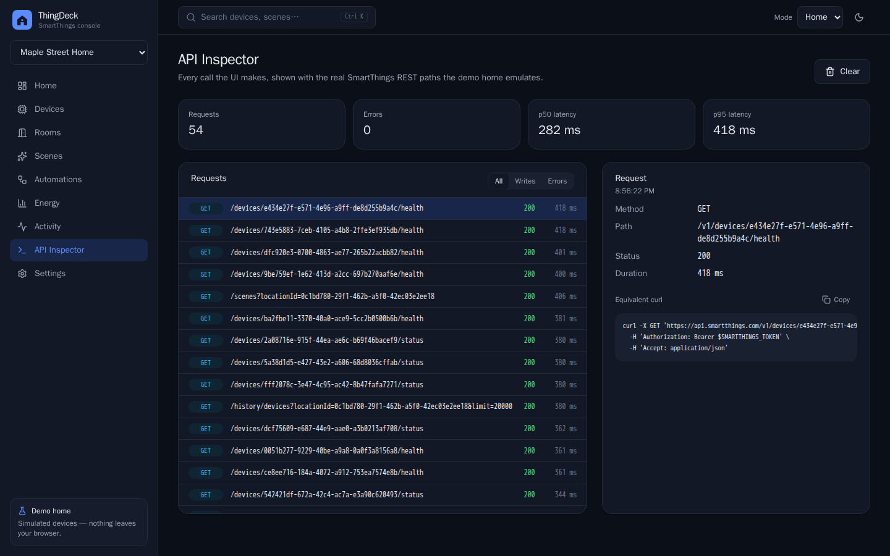
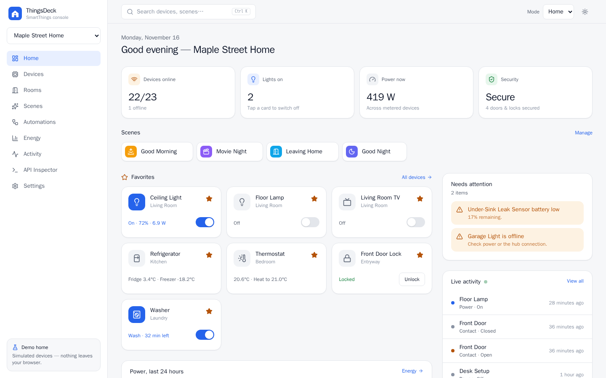
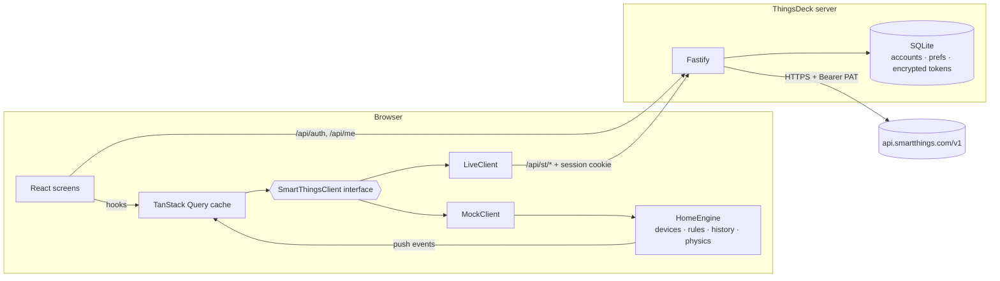

<div align="center">


# ThingsDeck

**A fast, capability-driven web console for SmartThings homes.**
Sign in, then explore a fully simulated two-location home, or connect your own SmartThings account with a personal access token.

[](https://github.com/rh-97/thingsdeck/actions/workflows/ci.yml)


</div>

---

## Why this exists

SmartThings already has an excellent mobile app. ThingsDeck is a **portfolio project** that explores what a _desktop-class_ console for the same platform could look like, built only on the **public** SmartThings REST API:

- See the whole home at once: health, alerts, power, live activity.
- Drive any device from a UI generated from its **capabilities**, not hard-coded per model.
- Build automations visually and get standard **Rules API** JSON out.
- Inspect every API call, with a ready-to-paste `curl` command.

It runs **without SmartThings hardware or a paid API plan**. Everyone gets a ThingsDeck account and picks **demo** or **live** once. The demo home is a full in-browser simulation, so anyone can clone it, register and click around in a couple of minutes.

> ThingsDeck is an independent open-source project. It is not affiliated with, endorsed by, or sponsored by Samsung or SmartThings.

## Features

|                                   |                                                                                                                                                                                                                     |
| --------------------------------- | ------------------------------------------------------------------------------------------------------------------------------------------------------------------------------------------------------------------- |
| 🏠 **Dashboard**                  | Greeting, KPIs (online devices, lights on, live power, security), scenes, favourites, "needs attention" alerts, 24 h power chart, live activity feed                                                                |
| 🎛️ **Capability-driven controls** | Switches, dimmers, white and colour light, thermostats (modes and setpoints), locks, garage doors, shades, TVs (playback, volume, input), fans, washer cycle with live countdown, robot vacuum                      |
| 📈 **History**                    | Per-attribute charts (6 h / 24 h / 7 d) with min/avg/max, plus a full event log per device                                                                                                                          |
| ⚡ **Energy**                     | Integrates power readings into kWh per device per day, cost estimate at your own rate, CSV export                                                                                                                   |
| 🤖 **Automations**                | Plain-English list of rules, enable/pause, JSON view, and a **visual rule builder** that emits Rules API bodies. The demo engine actually evaluates them                                                            |
| 🧪 **Simulate**                   | Demo-only panel: trigger a leak, smoke, motion or CO₂ spike and watch alerts and automations react                                                                                                                  |
| 🔎 **API Inspector**              | Every request with method, path, status and latency (p50/p95), and an equivalent `curl`                                                                                                                             |
| ⌨️ **Command palette**            | `⌘K` / `Ctrl K` / `/` to jump to any device, run scenes, or flip devices without leaving the keyboard                                                                                                               |
| 🔐 **Accounts**                   | ThingsDeck sign-in with self-registration, a one-time demo/live choice, preferences that follow you between devices, SmartThings tokens stored encrypted on the server, and a reconnect screen when a token expires |
| 🌗 **Polish**                     | Light, dark and system themes, °C/°F, responsive down to phones, keyboard-accessible dialogs, optimistic updates with rollback, skeleton loading states                                                             |

<table>
  <tr>
    <td></td>
    <td></td>
  </tr>
  <tr>
    <td></td>
    <td></td>
  </tr>
  <tr>
    <td></td>
    <td></td>
  </tr>
  <tr>
    <td></td>
    <td></td>
  </tr>
</table>

<p align="center">
  
  &nbsp;&nbsp;
  
</p>

## Quick start

Everything runs in Docker. Nothing gets installed on your machine except Docker itself.

```bash
git clone https://github.com/rh-97/thingsdeck.git && cd thingsdeck
make prod           # → http://localhost:8080
```

Open the page, **create an account**, and choose **Explore the demo home** or **Connect my SmartThings**. You only choose once; switch any time in Settings.

You only need **one** of `make prod` or `make dev`. Use `make prod` to _use_ ThingsDeck (optimised build behind nginx); use `make dev` while _changing the code_ (hot reload on port 5180). Both start the account server too.

Other targets (`make help` lists them all):

| Command            | What it does                                                           |
| ------------------ | ---------------------------------------------------------------------- |
| `make dev`         | Vite dev server with hot reload + API server, in `node:24` containers  |
| `make test`        | Vitest unit and component tests                                        |
| `make check`       | Typecheck, lint, tests and production build (what CI runs)             |
| `make e2e`         | Playwright smoke tests in the official Playwright image                |
| `make screenshots` | Regenerates every image in this README                                 |
| `make bundle`      | Packages pre-built images for a Linux server (`ARCH=amd64` or `arm64`) |
| `make prod`        | Builds the nginx + API server images and serves http://localhost:8080  |
| `make shell`       | Shell inside the dev container                                         |

`node_modules` lives in a named Docker volume, so the host and the container never share binaries. Change the port with `THINGSDECK_PORT=5200 make dev`.

### Sharing on your network

By default the containers only listen on `127.0.0.1`. To let other devices on your LAN use ThingsDeck, copy `.env.example` to `.env` and set:

```bash
THINGSDECK_BIND=0.0.0.0
```

Then run `make prod` (or `make dev`) and open `http://<this-machine's-IP>:8080` (or `:5180`) from any device. macOS may ask once to allow incoming connections for Docker.

Every person signs in with their own ThingsDeck account, so several people can use one server at once, each in demo mode or connected to a different SmartThings account. Over plain HTTP, passwords, session cookies and pasted tokens cross your LAN unencrypted on their way to the server, so use it on a network you trust, or put it behind an HTTPS reverse proxy. The session cookie is marked `Secure` automatically when served over HTTPS.

## Using your own SmartThings account (optional)

1. Create a token at **[account.smartthings.com/tokens](https://account.smartthings.com/tokens)** with the scopes
   `r:devices:* x:devices:* r:locations:* x:locations:* r:scenes:* x:scenes:* r:rules:* w:rules:*`.
2. Choose **Connect my SmartThings** after registering (or open **Settings → SmartThings connection**), paste the token and press **Connect**.

Notes:

- **Free.** Personal access tokens don't need the paid SmartThings Developer Plan, which covers OAuth "API Access" apps. SmartThings describes PATs as meant for personal testing and light scripts, which is exactly this use.
- **Tokens created after Dec 2024 expire after 24 hours.** When SmartThings starts rejecting a token, ThingsDeck shows a reconnect screen the next time it's used. Paste a fresh token and you're back where you were, or switch to the demo home.
- **The token lives on the server, not in the browser.** The server checks it with SmartThings, encrypts it (AES-256-GCM) and attaches it to API calls itself. The browser only ever talks to `/api` on its own origin; the SmartThings API doesn't allow browser CORS anyway.
- Live mode polls conservatively (status every 30–60 s, at most 4 requests in flight) to stay well inside the [rate limits](https://developer.smartthings.com/docs/getting-started/rate-limits).

## Accounts and security

The `server/` folder is a small Fastify service (Node 24 runs its TypeScript directly) with a SQLite database in a Docker volume.

- **Passwords** are hashed with scrypt; logins compare in constant time and are rate-limited per IP and email.
- **Sessions** are random 256-bit tokens in `httpOnly`, `SameSite=Lax` cookies, stored hashed, sliding 30-day expiry. Changing your password signs out your other devices.
- **CSRF:** state-changing requests must be JSON or carry `X-Requested-With`, which cross-site forms can't send.
- **SmartThings tokens** are encrypted with a key from `THINGSDECK_SECRET`, or one generated on first start and kept in the data volume. **Back up the `data` volume**: it holds accounts, preferences and that key.
- **Registration** is open by default. Set `THINGSDECK_SIGNUP=closed` in `.env` to stop new sign-ups once your team has accounts.

| Setting (`.env`)       | Default     | Purpose                                                  |
| ---------------------- | ----------- | -------------------------------------------------------- |
| `THINGSDECK_BIND`      | `127.0.0.1` | `0.0.0.0` shares ThingsDeck on your network              |
| `THINGSDECK_SIGNUP`    | `open`      | `closed` disables self-registration                      |
| `THINGSDECK_SECRET`    | generated   | 32-byte key (base64 or hex) for encrypting stored tokens |
| `THINGSDECK_PORT`      | `5180`      | Host port for `make dev`                                 |
| `THINGSDECK_PROD_PORT` | `8080`      | Host port for `make prod`                                |

The GitHub Pages build (`VITE_STATIC_DEMO=true`) has no server, so it skips accounts and is demo-only.

## Deploying to a Linux server

Build once on your own machine and copy the result, so a slow server never compiles anything:

```bash
make bundle ARCH=amd64   # or ARCH=arm64 — check the server with `uname -m`
```

`./bundle` then holds the images, a standalone `docker-compose.yml`, `.env.example` (listening on the network by default) and an empty `certs/` folder. Copy the folder to the server and follow `bundle/README.md`: `docker load`, then `docker compose up -d`. Idle, ThingsDeck uses about 115 MB of RAM and almost no CPU.

### Company networks

- **HTTPS inspection:** if your network uses its own root certificate, drop it into `certs/`. Binary (`.cer`, `.der`) or text (`.crt`, `.pem`) both work. The server trusts it on start and logs `Trusting extra CA from …`.
- **Proxy:** only if your network requires one, set `HTTPS_PROXY` (and optionally `NO_PROXY`) in `.env`.

Both are optional and do nothing when unset.

## Architecture



**One seam, two backends.** Every screen talks to a single `SmartThingsClient` interface ([`src/api/client.ts`](src/api/client.ts)) shaped after the public REST API. `LiveClient` is a dependency-free `fetch` wrapper with pagination, concurrency limiting and typed errors. `MockClient` wraps `HomeEngine`, an in-memory home that:

- seeds 27 devices across 2 locations with realistic capabilities and multi-component devices (the fridge has `main`, `cooler` and `freezer`),
- executes commands with validation (`422` for unsupported commands, `409` for offline devices),
- runs a small simulation: thermostat feedback loop, fridge compressor cycling, CO₂ drift, washer stages, vacuum battery and docking, garage door transitions, random motion and door events,
- evaluates a subset of the **Rules API** (`equals` / `greaterThan` / `lessThan` with edge triggering, nested `if`, command actions),
- backfills seven days of deterministic history (seeded PRNG), so charts are full on first load,
- adds latency and optional failure injection, so optimistic updates and rollback are visible.

**Capability-driven UI.** [`src/capabilities`](src/capabilities) turns capability IDs into summaries, primary actions, alerts, chartable series and controls. A new device type "just works" if it uses standard capabilities, the same idea SmartThings uses for its own device presentations.

**State.** Server state lives in TanStack Query; pushed events are written straight into the cache (`setQueryData`), so every screen updates live without polling. UI preferences live in a small persisted Zustand store.

### Project layout

```
src/
├─ api/            SmartThingsClient interface, LiveClient, MockClient + HomeEngine, seed data
├─ auth/           sign-in/register pages, auth gate, first-run choice, reconnect, preference sync
├─ capabilities/   capability → summary/action/alert/format logic, rule builder
├─ components/     layout shell, device cards/controls, UI primitives, command palette
├─ hooks/          query hooks, optimistic updates, live event wiring
├─ pages/          one file per route (lazy-loaded)
├─ store/          settings (synced to the account), toasts, activity log
└─ lib/            time-series maths, CSV, storage, helpers
server/            Fastify API: accounts, sessions, preferences, encrypted tokens, SmartThings proxy, CA/proxy launcher
deploy/            Standalone compose file and guide used by `make bundle`
e2e/               Playwright smoke + account journeys, README screenshot generator
```

## Testing

- **Server:** registration and login, rate limiting, session expiry, closed sign-up, CSRF guard, per-account preferences, token validation and encryption at rest, the SmartThings proxy, expiry detection, password change and account deletion (Fastify `inject` with an in-memory database), plus loading binary and text company CAs and proving an HTTPS connection is trusted only with the CA.
- **Unit:** engine behaviour (commands, rules, scenes, washer cycle, determinism, plausible sensor ranges), REST client (cookies not tokens, pagination, error mapping, concurrency), optimistic updates, time-series integration, rule builder.
- **Component:** Testing Library against a latency-free demo home (toggle a light, search, confirm before unlocking).
- **E2E:** Playwright drives the real app: sign-in redirect, register → choose demo → sign out and back in, wrong-password error, live mode without a token, dashboard, toggles, command palette, simulated motion firing an automation, building a rule, and an error-free render of every route.

```bash
make test   # unit + component
make e2e    # browser smoke tests
```

## Tech stack

React 19 · Fastify 5 · Node 24 (built-in SQLite and TypeScript) · TypeScript (strict, `noUncheckedIndexedAccess`) · Vite 8 · Tailwind CSS 4 · TanStack Query 5 · React Router 7 · Zustand · Recharts · Lucide · Vitest · Testing Library · Playwright · ESLint (typescript-eslint, React Hooks / React Compiler rules) · Prettier · Docker · nginx · GitHub Actions

## Roadmap

- Optional "Sign in with SmartThings" OAuth flow with automatic token refresh, for self-hosters on the SmartThings Developer Plan
- Server-sent events for live mode instead of polling
- Drag-and-drop dashboard layout
- Companion projects: a Lua **Edge driver** for a DIY ESP32 sensor, and an ESP32 **Matter** device with an iOS commissioning app

## License

[MIT](LICENSE)
