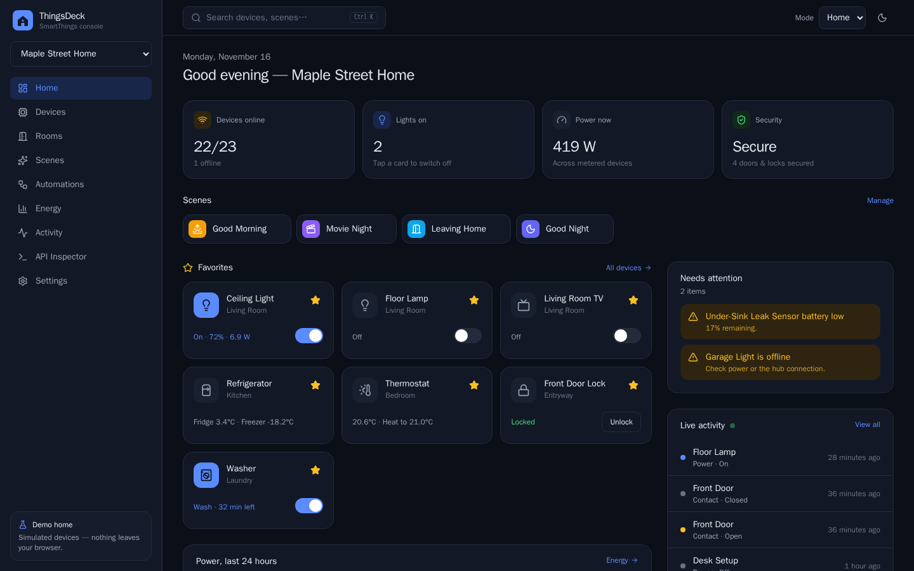
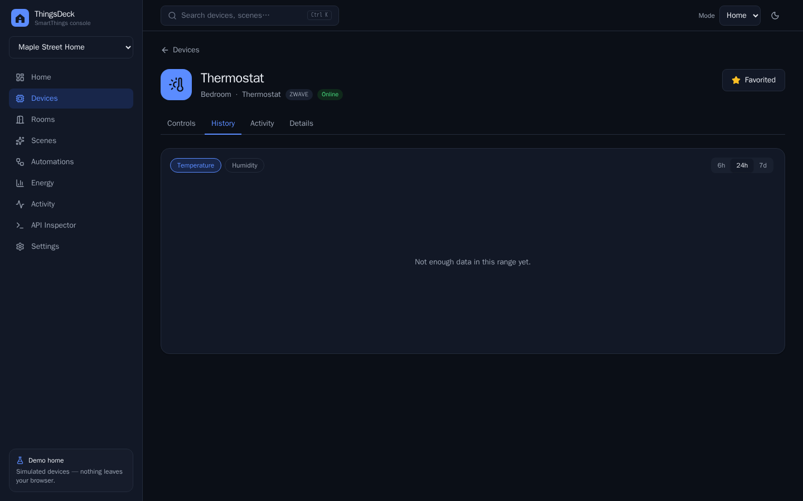
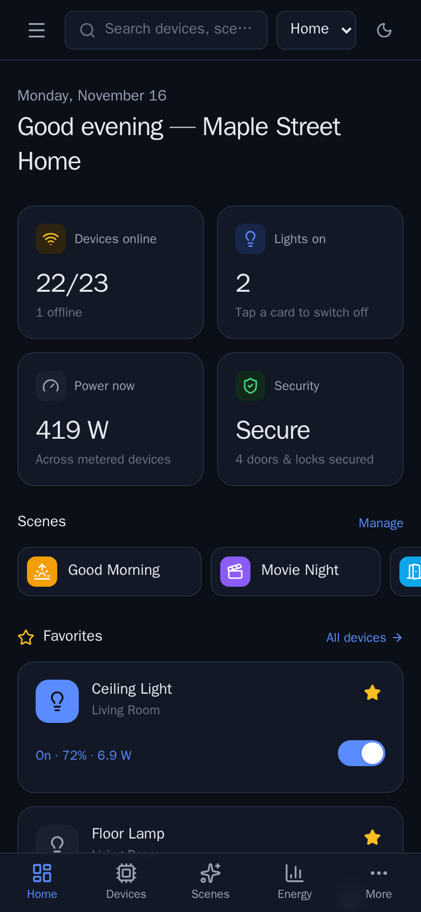
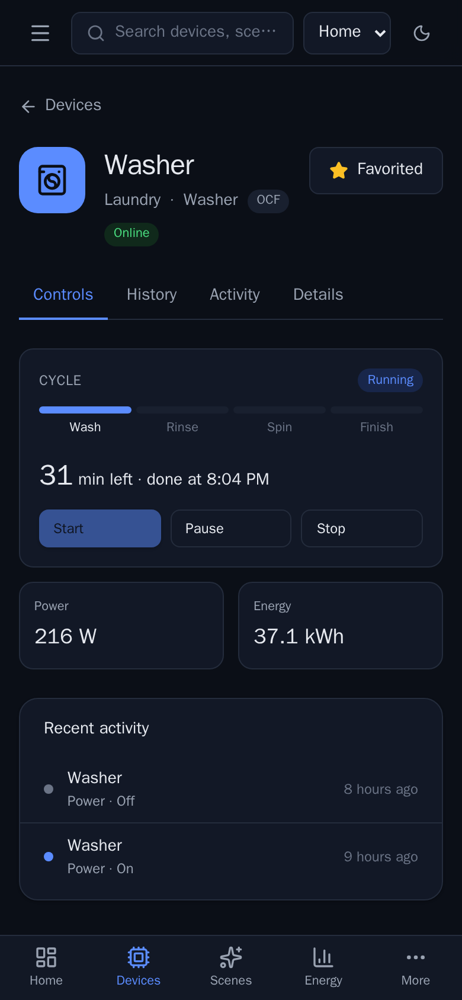
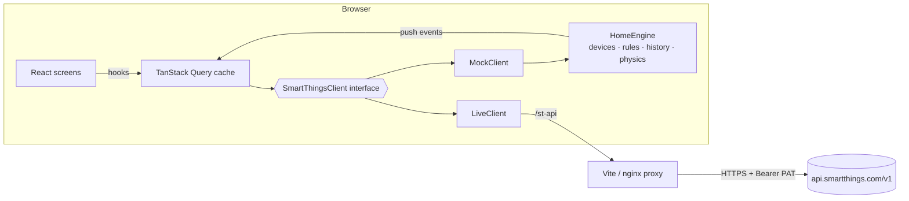

<div align="center">


# ThingsDeck

**A fast, capability-driven web console for SmartThings homes.**
Runs fully offline against a simulated two-location home. Or point it at your own SmartThings account with a personal access token.

[](https://github.com/rh-97/thingsdeck/actions/workflows/ci.yml)




</div>

---

## Why this exists

SmartThings already has an excellent mobile app. ThingsDeck is a **portfolio project** that explores what a _desktop-class_ console for the same platform could look like, built only on the **public** SmartThings REST API:

- See the whole home at once: health, alerts, power, live activity.
- Drive any device from a UI generated from its **capabilities**, not hard-coded per model.
- Build automations visually and get standard **Rules API** JSON out.
- Inspect every API call, with a ready-to-paste `curl` command.

It runs **without an account, hardware, or a paid API plan**. The demo home is a full in-browser simulation, so anyone can clone it and click around in under a minute.

> ThingsDeck is an independent open-source project. It is not affiliated with, endorsed by, or sponsored by Samsung or SmartThings.

## Features

|                                   |                                                                                                                                                                                                |
| --------------------------------- | ---------------------------------------------------------------------------------------------------------------------------------------------------------------------------------------------- |
| 🏠 **Dashboard**                  | Greeting, KPIs (online devices, lights on, live power, security), scenes, favourites, "needs attention" alerts, 24 h power chart, live activity feed                                           |
| 🎛️ **Capability-driven controls** | Switches, dimmers, white and colour light, thermostats (modes and setpoints), locks, garage doors, shades, TVs (playback, volume, input), fans, washer cycle with live countdown, robot vacuum |
| 📈 **History**                    | Per-attribute charts (6 h / 24 h / 7 d) with min/avg/max, plus a full event log per device                                                                                                     |
| ⚡ **Energy**                     | Integrates power readings into kWh per device per day, cost estimate at your own rate, CSV export                                                                                              |
| 🤖 **Automations**                | Plain-English list of rules, enable/pause, JSON view, and a **visual rule builder** that emits Rules API bodies. The demo engine actually evaluates them                                       |
| 🧪 **Simulate**                   | Demo-only panel: trigger a leak, smoke, motion or CO₂ spike and watch alerts and automations react                                                                                             |
| 🔎 **API Inspector**              | Every request with method, path, status and latency (p50/p95), and an equivalent `curl`                                                                                                        |
| ⌨️ **Command palette**            | `⌘K` / `Ctrl K` / `/` to jump to any device, run scenes, or flip devices without leaving the keyboard                                                                                          |
| 🌗 **Polish**                     | Light, dark and system themes, °C/°F, responsive down to phones, keyboard-accessible dialogs, optimistic updates with rollback, skeleton loading states                                        |

<table>
  <tr>
    <td></td>
    <td></td>
  </tr>
  <tr>
    <td></td>
    <td></td>
  </tr>
  <tr>
    <td></td>
    <td></td>
  </tr>
</table>

<p align="center">
  
  &nbsp;&nbsp;
  
</p>

## Quick start

Everything runs in Docker. Nothing gets installed on your machine except Docker itself.

```bash
git clone https://github.com/rh-97/thingsdeck.git && cd thingsdeck
make dev            # → http://localhost:5180
```

Other targets (`make help` lists them all):

| Command            | What it does                                                  |
| ------------------ | ------------------------------------------------------------- |
| `make dev`         | Vite dev server with hot reload, in a `node:24` container     |
| `make test`        | Vitest unit and component tests                               |
| `make check`       | Typecheck, lint, tests and production build (what CI runs)    |
| `make e2e`         | Playwright smoke tests in the official Playwright image       |
| `make screenshots` | Regenerates every image in this README                        |
| `make prod`        | Builds the nginx image and serves it on http://localhost:8080 |
| `make shell`       | Shell inside the dev container                                |

`node_modules` lives in a named Docker volume, so the host and the container never share binaries. Change the port with `THINGSDECK_PORT=5200 make dev`.

## Using your own SmartThings account (optional)

1. Create a token at **[account.smartthings.com/tokens](https://account.smartthings.com/tokens)** with the scopes
   `r:devices:* x:devices:* r:locations:* x:locations:* r:scenes:* x:scenes:* r:rules:* w:rules:*`.
2. In ThingsDeck, open **Settings → Personal access token**, paste it and press **Connect**.

Notes:

- **Free.** Personal access tokens don't need the paid SmartThings Developer Plan, which covers OAuth "API Access" apps. SmartThings describes PATs as meant for personal testing and light scripts, which is exactly this use.
- **Tokens created after Dec 2024 expire after 24 hours.** ThingsDeck detects the `401` and asks for a fresh one.
- **Requests go through a same-origin proxy** (`/st-api → https://api.smartthings.com/v1`): Vite's proxy in dev, nginx in the production image. The SmartThings API doesn't allow browser CORS, so the static GitHub Pages build is demo-only.
- The token stays in `sessionStorage` unless you tick _Remember on this device_, and it's never logged.
- Live mode polls conservatively (status every 30–60 s, at most 4 requests in flight) to stay well inside the [rate limits](https://developer.smartthings.com/docs/getting-started/rate-limits).

## Architecture



**One seam, two backends.** Every screen talks to a single `SmartThingsClient` interface ([`src/api/client.ts`](src/api/client.ts)) shaped after the public REST API. `LiveClient` is a dependency-free `fetch` wrapper with pagination, concurrency limiting and typed errors. `MockClient` wraps `HomeEngine`, an in-memory home that:

- seeds 27 devices across 2 locations with realistic capabilities and multi-component devices (the fridge has `main`, `cooler` and `freezer`),
- executes commands with validation (`422` for unsupported commands, `409` for offline devices),
- runs a small simulation: thermostat feedback loop, fridge compressor cycling, CO₂ drift, washer stages, vacuum battery and docking, garage door transitions, random motion and door events,
- evaluates a subset of the **Rules API** (`equals` / `greaterThan` / `lessThan` with edge triggering, nested `if`, command actions),
- backfills seven days of deterministic history (seeded PRNG), so charts are full on first load,
- adds latency and optional failure injection, so optimistic updates and rollback are visible.

**Capability-driven UI.** [`src/capabilities`](src/capabilities) turns capability IDs into summaries, primary actions, alerts, chartable series and controls. A new device type "just works" if it uses standard capabilities, the same idea SmartThings uses for its own device presentations.

**State.** Server state lives in TanStack Query; pushed events are written straight into the cache (`setQueryData`), so every screen updates live without polling. UI preferences live in a small persisted Zustand store.

### Project layout

```
src/
├─ api/            SmartThingsClient interface, LiveClient, MockClient + HomeEngine, seed data
├─ capabilities/   capability → summary/action/alert/format logic, rule builder
├─ components/     layout shell, device cards/controls, UI primitives, command palette
├─ hooks/          query hooks, optimistic updates, live event wiring
├─ pages/          one file per route (lazy-loaded)
├─ store/          settings (persisted), toasts, activity log
└─ lib/            time-series maths, CSV, storage, helpers
e2e/               Playwright smoke tests + README screenshot generator
```

## Testing

- **Unit:** engine behaviour (commands, rules, scenes, washer cycle, determinism, plausible sensor ranges), REST client (auth header, pagination, error mapping, concurrency), optimistic updates, time-series integration, rule builder.
- **Component:** Testing Library against a latency-free demo home (toggle a light, search, confirm before unlocking).
- **E2E:** Playwright drives the real app: dashboard, toggles, command palette, simulated motion firing an automation, building a rule, and an error-free render of every route.

```bash
make test   # unit + component
make e2e    # browser smoke tests
```

## Tech stack

React 19 · TypeScript (strict, `noUncheckedIndexedAccess`) · Vite 8 · Tailwind CSS 4 · TanStack Query 5 · React Router 7 · Zustand · Recharts · Lucide · Vitest · Testing Library · Playwright · ESLint (typescript-eslint, React Hooks / React Compiler rules) · Prettier · Docker · nginx · GitHub Actions

## Roadmap

- OAuth "API Access" app flow (for users on the SmartThings Developer Plan) next to PATs
- Server-sent events for live mode instead of polling
- Drag-and-drop dashboard layout
- Companion projects: a Lua **Edge driver** for a DIY ESP32 sensor, and an ESP32 **Matter** device with an iOS commissioning app

## License

[MIT](LICENSE)
